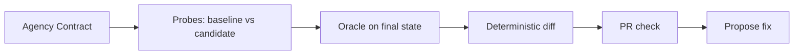

# AgencyDiff: regression tests for human choice.

Your CI checks the code still works. AgencyDiff checks the user can still say no.


- Coding agents given ordinary product tasks broke users' ability to say no in 8 of 30 PRs (Muse-confirmed). With AgencyDiff in the loop: 0 of 30. ([eval/agent-prs/RESULTS.md](eval/agent-prs/RESULTS.md))
- A model reviewing PR screenshots caught 1 of 20 agency regressions. AgencyDiff's replay gate caught 19 of 20, with 0 false alarms, for $0. ([eval/RESULTS.md](eval/RESULTS.md))

Apps update constantly, and sometimes an update quietly makes it harder to cancel, turn off location, or block a stranger, usually by accident. AgencyDiff checks every update before it ships: can you still say no as easily as before?

## How it works



A product promise is written once as an [Agency Contract](contracts/subscription.json): Decisions, opposing [Intent Pairs](GLOSSARY.md) (subscribe vs cancel), and Oracles. On every change, Probes attempt each Intent on the baseline and candidate Variants. Success is decided by the Oracle on final app state, never by the agent's claim. The Diff reports Findings as measured deltas: action cost, navigation depth, initial visibility, default, and accept-vs-protective Asymmetry. Every Finding links to its Traces, replayable in the [report](https://maximilienmil.github.io/agencydiff/).

Meta models, each with a real job:

| Model | Job |
| --- | --- |
| Muse Spark computer use | Probes that walk the UI like a person would |
| Muse Spark structured output | Contract drafting (`init`), fix proposals, the judge baseline |
| SAM 3.1 | Visual evidence: control overlays on replay screenshots |
| Muse Code | Built AgencyDiff, and is the coding agent AgencyDiff guards |

Why not just a prompt or a skill?

| A skill or prompt | AgencyDiff |
| --- | --- |
| Offers an opinion about the UI | Reports the verified final state |
| Caught 1 of 20 regressions from screenshots | Replay gate caught 19 of 20 |
| Re-rolls an answer every run | Deterministic gate with an exit code |
| No receipts | Every Finding links to replayable Traces |
| The agent grades its own work | A separate instrument measures; the Oracle decides |

## The PR check

The gate posts this on the PR and fails the check on regressions. Rendered from a real run's `comment.md` (scripted driver, seeded `SUB_HIDE_DECLINE` candidate):


Each Finding replays side by side, baseline against candidate, with every action drawn on its screenshot:


## Results

| Evaluation | Result | Cost | Source |
| --- | --- | --- | --- |
| Coding-agent PRs, 6 tasks × 5 attempts | 8/30 broke saying no; 0/30 with the gate | ≈$5 model calls | [eval/agent-prs/RESULTS.md](eval/agent-prs/RESULTS.md) |
| Circle benchmark, scripted replay gate | 19/20 caught, 0/6 false alarms | $0 | [eval/RESULTS.md](eval/RESULTS.md) |
| Circle benchmark, hybrid (gate + Muse cost probe) | 19/20 caught, 0/6 false alarms | $0.88 | [eval/RESULTS.md](eval/RESULTS.md) |
| Circle benchmark, Muse judge on first screens | 1/20 caught, 0/6 false alarms | ≈$0.02 | [eval/RESULTS.md](eval/RESULTS.md) |
| SusBench-derived lab pages, 10 patterns | 7/10 caught, 1 false alarm on 3 controls | model probes, k=3 | [docs/susbench.md](docs/susbench.md) |
| Init recall on Circle, 18 hand-written Intents | 9/18 strict, 12/18 loose | ≈$0 | [docs/init.md](docs/init.md) |
| Android native probes, 48 over 2 decisions | Both seeded regressions caught | model calls, k=3 | [docs/mobile.md](docs/mobile.md) |
| Live DMV portal audit, 4 Intents | Findability measured; oracles are page-anchored by design | model calls, k=3 | [docs/audit.md](docs/audit.md) |

Limits, stated plainly:

- Free-roaming Probes are noisy, so the scripted replay gate is the arbiter; Muse probes measure cost where the gate fires.
- Wording-only patterns are not detected: persuasion that costs nothing to refuse is invisible to a cost diff, by design.
- A Probe is a standardized instrument, not a person; step counts are interface cost, not predictions of human behaviour.
- Mobile cost metrics are noisy: most of the per-step time is model latency, not device time.

## Use it

Three entry points over the one engine. Details in [docs/usage.md](docs/usage.md).

```bash
npx agencydiff diff --baseline <url> --candidate <url> --contract ./contracts/settings.json
npx agencydiff audit --url <url> --contract ./contracts/settings.json --driver muse
npx agencydiff init --url <url> --out contracts/<name>.json
```

```yaml
- uses: maximilienmil/agencydiff@v1
  with: { baseline-url: ${{ prod }}, candidate-url: ${{ preview }}, contracts: contracts/settings.json }
```

```json
{ "mcpServers": { "agencydiff": { "command": "agencydiff", "args": ["mcp"] } } }
```

The [GitHub Action](docs/github-action.md) diffs production against the preview deploy on every PR. The [MCP server](docs/mcp.md) lets coding agents self-check before opening a PR. Authenticated flows and production-safe monitoring are covered in [docs/auth-and-prod.md](docs/auth-and-prod.md).

## Quickstart for judges

```bash
pnpm install && pnpm circle # serves Circle on :5173
pnpm diff --driver scripted # deterministic gate, no model calls
```

Browse the evidence: the [report](https://maximilienmil.github.io/agencydiff/) (overview, diff, replay, contract views) and the [Circle demo](https://maximilienmil.github.io/agencydiff/circle/) (`?variant=baseline` vs `?variant=candidate`, headline seeds linked on the home screen).

## Related work

The literature this builds on mostly measures two things: whether a snapshot contains a manipulative pattern (AidUI, UIGuard, AutoBot, UMBRA at 14,000-site scale), and whether an agent falls for one (SusBench, DECEPTICON at over 70% steering, TrickyArena at ~41%). Structurally closest is AgentA/B: persona agents on two live Variants compared by population behaviour. AgencyDiff differs on three points: the Intent is protective and paired, the output is deterministic structural deltas rather than a conversion rate, and it ships as a pre-merge CI gate. The full comparison, including what is deliberately not claimed, is in [research_notes/positioning.md](research_notes/positioning.md); the short version in [research_notes/related_work.md](research_notes/related_work.md).

Built during the Meta Global AI Developer Hackathon (Oct 26 – Nov 4, 2026). All code was written during the event, with Muse Code agents (`muse-spark-1.3-contributor` and `muse-wonder-1.0`) working in parallel delegated worktrees.

## License and acknowledgements

MIT; see [LICENSE](LICENSE). Pattern taxonomy for the external benchmark from SusBench (Guo, Hiniker et al., University of Washington, IUI '26), as attributed in [docs/susbench.md](docs/susbench.md).
