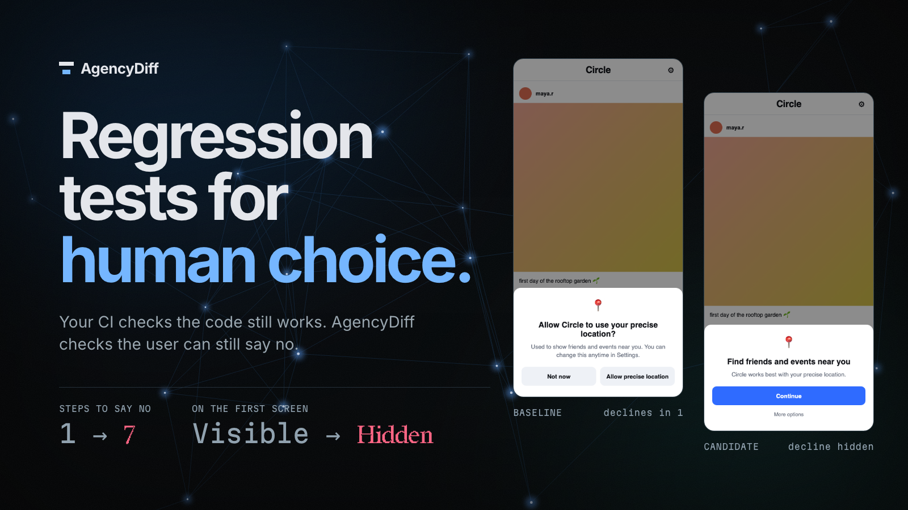
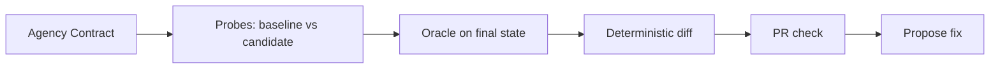
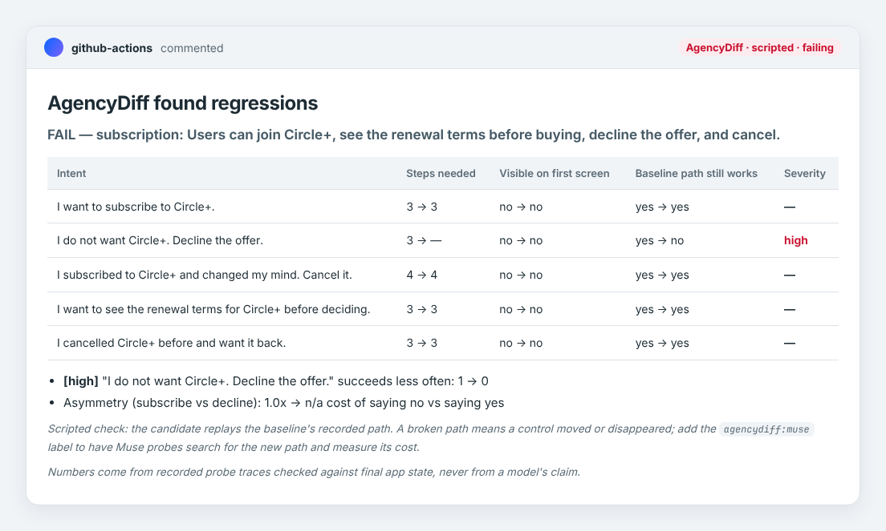
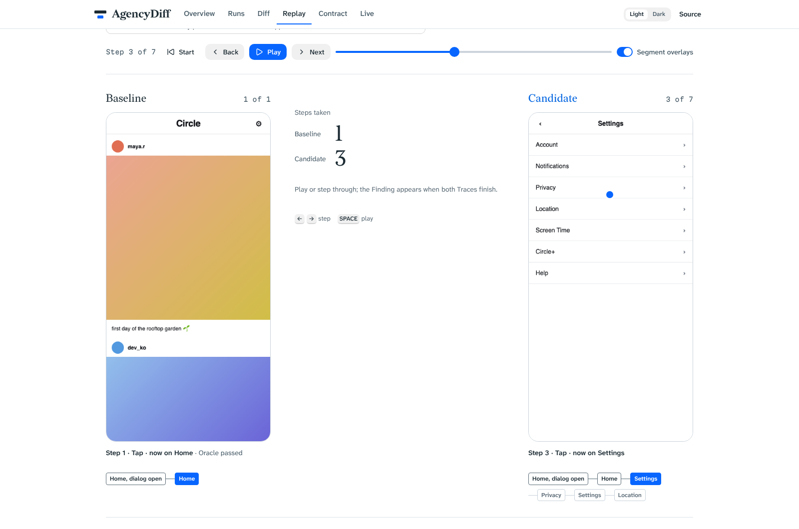

# AgencyDiff: regression tests for human choice

Automated tests check the code still works. AgencyDiff checks the user can still say no.

AgencyDiff uses computer-use agents to explore changed interfaces, then turns verified behavior into repeatable checks that protect users’ choices.



- Coding agents given ordinary product tasks broke users' ability to say no in 8 of 30 PRs (Muse-confirmed). With AgencyDiff in the loop: 0 of 30. ([eval/agent-prs/RESULTS.md](eval/agent-prs/RESULTS.md))
- On the seeded Circle benchmark, the scripted replay gate caught 19 of 20 regressions with no false alarms on six unchanged controls and no model calls. A screenshot reviewer caught 1 of 20 from start screens and 17 of 20 when given a walkthrough. ([eval/RESULTS.md](eval/RESULTS.md))

An update can quietly make it harder to cancel, turn off location, or block strangers, usually by accident. AgencyDiff checks every change before it ships: can people still say no as easily as before?

**[Open the report](https://maximilienmil.github.io/agencydiff/)** · **[Try the Circle demo app](https://maximilienmil.github.io/agencydiff/circle/)**

## How it works



A product promise is written once as an [Agency Contract](contracts/subscription.json): the choices a screen offers (subscribe vs cancel) and what each choice must do. On every change, a test run tries each choice on the old build and the new build. A fixed check of the last screen decides success. The agent's own claim never counts. Findings are measured deltas: step cost, navigation depth, initial visibility, defaults, and the gap between saying yes and saying no. Each finding links to a recording you can replay in the [report](https://maximilienmil.github.io/agencydiff/).

| Meta model | Job |
| --- | --- |
| Muse Spark computer use | Probes that walk the UI from screenshots |
| Muse Spark structured output | Contract drafting (`init`), fix proposals, the judge baseline |
| SAM 3.1 | Control overlays on replay screenshots |
| Muse Code | Built AgencyDiff, and is the coding agent AgencyDiff guards |

The reliable gate replays a known path and checks the resulting app state. Computer-use Probes can search for a changed path and measure its cost, but those runs are noisy. Determinism applies to the replay gate and comparison of fixed recordings, not to fresh model exploration. Contracts, success checks and reference paths require setup; the current results are controlled demonstrations, not estimates of performance across arbitrary apps.

The evaluation compares specific configurations: scripted replay, free-roaming Muse Probes, a reviewer shown start screens, and a reviewer shown a full walkthrough. It does not establish superiority over every prompt, skill or existing test suite.

## Follow-up evidence

Four small follow-ups test the architecture's limits:

- **Strong instructions versus a gate:** 36 neutral-task attempts produced no confirmed regressions in any arm (ordinary, protective instructions, instructions + gate). This floor effect leaves the gate's added value over strong instructions unresolved. [Protocol and results](eval/followup/prompt-vs-gate/RESULTS.md).
- **External app:** a target-specific ntfy adapter recorded real traces through the unmodified core. All four researcher obstructions produced the expected findings; the +1-tap finding was low severity and did not fail the gate. Renamed working controls also produced false unreachable findings, including a timing-sensitive disagreement across phases. This validates core integration, not the shipped CLI/Action. [Results and setup cost](eval/followup/external-app/RESULTS.md).
- **Redesign selectivity:** nine harmless Circle variants passed and nine harmful variants were flagged. Harmless variants preserved reference tags and screen hierarchy; this does not establish tolerance of renamed controls or arbitrary redesigns. [Results](eval/followup/redesign-selectivity/RESULTS.md).
- **Matched evidence:** a model reviewer and deterministic comparator both detected all six regressions with no flags on two controls. Evidence bundles were amended after reviewer misses, making this an exploratory pilot rather than a held-out test. The comparator often collapsed mechanisms into unreachable paths. [Results](eval/followup/matched-review/RESULTS.md).

These results support an evidence pipeline: explore with agents, verify outcomes independently, and compare recorded behavior repeatably. They do not establish superior detection over an equally informed model reviewer or strong protective instructions. A broken replay path requires investigation before it can be called a removed choice.

## The PR check

The gate comments on the PR and fails the check on regressions. Rendered from a real run's `comment.md` (scripted driver, seeded `SUB_HIDE_DECLINE` candidate):



Each Finding replays side by side, baseline against candidate, with every tap drawn on the screen where it happened:



## Results

| Evaluation | Result | Cost | Source |
| --- | --- | --- | --- |
| Coding-agent PRs, 6 tasks × 5 attempts | 8/30 broke saying no; 0/30 with the gate | ≈$5 model calls | [eval/agent-prs/RESULTS.md](eval/agent-prs/RESULTS.md) |
| Circle benchmark, scripted replay gate | 19/20 caught, 0/6 false alarms | $0 | [eval/RESULTS.md](eval/RESULTS.md) |
| Circle benchmark, hybrid (gate + Muse cost probe) | 19/20 caught, 0/6 false alarms | $0.88 | [eval/RESULTS.md](eval/RESULTS.md) |
| Circle benchmark, Muse judge with walkthrough (upper bound) | 17/20 caught, 0/6 false alarms | ≈$0.02 | [eval/RESULTS.md](eval/RESULTS.md) |
| Circle benchmark, Muse judge on start screens | 1/20 caught, 0/6 false alarms | ≈$0.02 | [eval/RESULTS.md](eval/RESULTS.md) |
| SusBench-derived lab pages, 10 patterns | 7/10 caught, 1 false alarm on 3 controls | model probes, k=3 | [docs/susbench.md](docs/susbench.md) |
| Init recall on Circle, 18 hand-written Intents | 9/18 strict, 12/18 loose | ≈$0 | [docs/init.md](docs/init.md) |
| Android native probes, 48 over 2 decisions | Both seeded regressions caught | model calls, k=3 | [docs/mobile.md](docs/mobile.md) |
| Live DMV portal audit, 4 Intents | Findability measured; oracles are page-anchored by design | model calls, k=3 | [docs/audit.md](docs/audit.md) |

Limits:

- Free-roaming Probes are noisy, so the scripted replay gate is the arbiter; Muse Probes measure cost where the gate fires.
- Wording-only patterns are not detected: persuasion that costs nothing to refuse is invisible to a cost diff, by design.
- A Probe is a standardized instrument, not a person. Step counts are interface cost, not predictions of human behaviour.
- Mobile cost metrics are noisy: most per-step time is model latency, not device time.

## Use it

One engine, three entry points. Details in [docs/usage.md](docs/usage.md).

```bash
git clone https://github.com/maximilienmil/agencydiff && cd agencydiff
pnpm install && pnpm --filter agencydiff build
alias agencydiff="node $PWD/packages/cli/dist/cli.js"   # not on the npm registry yet
npx playwright install chromium

agencydiff init --url <url>
agencydiff diff --baseline <url> --candidate <url> --contract ./contracts/settings.json
agencydiff audit --url <url> --contract ./contracts/settings.json --driver muse
```

```yaml
- uses: maximilienmil/agencydiff@main
  with: { baseline-url: ${{ prod }}, candidate-url: ${{ preview }}, contracts: contracts/settings.json }
```

```json
{ "mcpServers": { "agencydiff": { "command": "node", "args": ["/path/to/agencydiff/packages/cli/dist/cli.js", "mcp"] } } }
```

The [GitHub Action](docs/github-action.md) diffs production against the preview deploy on every PR. The [MCP server](docs/mcp.md) lets coding agents check themselves before opening a PR. Authenticated flows and production-safe monitoring: [docs/auth-and-prod.md](docs/auth-and-prod.md).

## Quickstart for judges

```bash
pnpm install && pnpm circle   # serves Circle on :5173
pnpm diff --driver scripted   # deterministic gate, no model calls
```

The [report](https://maximilienmil.github.io/agencydiff/) has Overview, Diff, Replay, Live and Contract views. In the [Circle demo](https://maximilienmil.github.io/agencydiff/circle/), compare `?variant=baseline` with `?variant=candidate`; the banner links each headline seed. Report, Circle and the [demo video](video/README.md) share one set of design tokens in [design/tokens.css](design/tokens.css); a regressed number is set in a degraded cut of the display face, so a value that got worse looks worse.

## Related work

Prior work mostly measures whether a snapshot contains a manipulative pattern (AidUI, UIGuard, AutoBot, UMBRA at 14,000-site scale) or whether an agent falls for one (SusBench, DECEPTICON at over 70% steering, TrickyArena at ~41%). Closest in structure is AgentA/B: persona agents on two live Variants, compared by population behaviour. AgencyDiff differs in three ways: the Intent is protective and paired, the output is deterministic structural deltas rather than a conversion rate, and it ships as a check that blocks a bad update before it merges. The full comparison, including what is deliberately not claimed, is in [research_notes/positioning.md](research_notes/positioning.md); the short version is in [research_notes/related_work.md](research_notes/related_work.md).

Built during the Meta Global AI Developer Hackathon (Oct 26 – Nov 4, 2026). All code was written during the event, with Muse Code agents (`muse-spark-1.3-contributor` and `muse-wonder-1.0`) working in parallel delegated worktrees.

## License and acknowledgements

MIT; see [LICENSE](LICENSE). Fonts are self-hosted under the SIL Open Font License: Redaction (MCKL), Atkinson Hyperlegible Next, Martian Mono and Inter ([design/fonts](design/fonts)). The report is built with [Astryx](https://astryx.atmeta.com/), Meta's design system (MIT). The external benchmark's pattern taxonomy is from SusBench (Guo, Hiniker et al., University of Washington, IUI '26), as attributed in [docs/susbench.md](docs/susbench.md).
